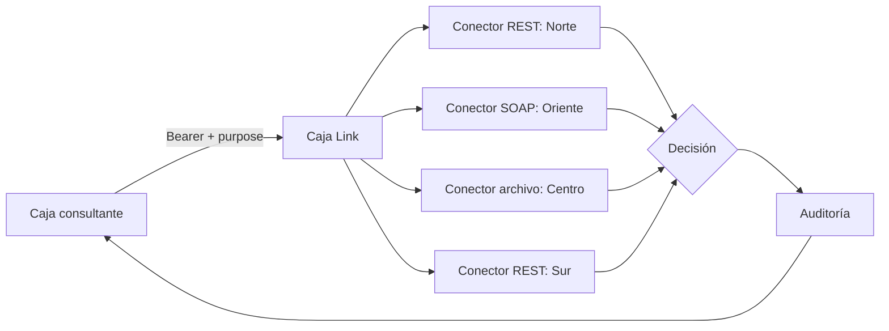

# Arquitectura

<!--
Plantilla con el formato obligatorio: cada sección cuenta solo si tiene al menos 20 palabras
(estos comentarios no cuentan). "Alternativas descartadas" necesita al menos 2 alternativas en lista
("- ..."), cada una con el motivo por el que se descartó.
Revisen con: ./validator entregables
-->

## Contexto

Una persona no puede estar afiliada a dos cajas de compensación al mismo tiempo, pero cada caja guarda sus afiliaciones en su propio sistema y no hay un lugar común donde revisarlo. Caja Link es el servicio que permite a una caja preguntar, con un número de documento, si esa persona tiene afiliación vigente en otra caja.

Las cuatro cajas son distintas entre sí:

- **Caja Norte:** API REST con JSON, autenticada con el encabezado `X-Api-Key`.
- **Caja Oriente:** servicio SOAP con usuario y contraseña; exige el documento con 12 dígitos y entrega fechas `dd/mm/aaaa`.
- **Caja Centro:** no tiene servicio en línea; cada noche publica un archivo plano separado por `|` con su fecha de corte.
- **Caja Sur:** la cuarta caja, otra API REST con nombres de campos en inglés y token Bearer. Se activa por configuración.

Restricciones que guían el diseño (las decisiones están en [docs/adr/](adr/)): la Ley 1581 (toda consulta declara su finalidad y solo se entrega el dato mínimo: caja y vigencia, nunca nombre, salario ni datos de contacto), una respuesta en menos de 5 segundos aunque una caja esté lenta, y la regla de no afirmar "no afiliado" cuando una caja no pudo responder.

## Componentes

Todo corre en un solo servicio FastAPI (`src/app`), que levanta `docker compose` junto con las cajas simuladas (`caja-norte`, `caja-oriente`, `caja-sur`) y el servicio `tests`.

- **Rutas (`src/app/api/`):** reciben las peticiones de la consulta v1 y v2, el lote y la auditoría, y devuelven las respuestas del contrato. Además, `/health` (sin token) lo usa el `healthcheck` de Compose, y `/docs` muestra el contrato `openapi.yaml` con sus ejemplos.
- **Autenticación (`src/app/auth.py`):** identifica a la caja por su token Bearer. El token de administrador solo sirve para leer la auditoría.
- **Catálogo de cajas (`config/cajas.yaml` y `src/app/config.py`):** declara cada caja, su protocolo, cómo se llaman sus campos, sus tiempos máximos y los nombres de las variables de `.env` que guardan sus credenciales. Sumar una caja que usa un protocolo conocido no requiere tocar código.
- **Conectores (`src/app/connectors/`):** uno por protocolo (`rest-json`, `soap`, `flat-file`). Cada conector habla con la caja y traduce su respuesta al modelo común `Affiliation`, que solo tiene caja, fechas, fuente, fecha de corte y tipo de afiliado. Ahí se descartan los datos personales. La clase base aplica los tiempos máximos y los reintentos.
- **Servicio de consulta (`src/app/domain/service.py`):** pregunta a todas las cajas en paralelo, excepto a la que consulta, filtra las afiliaciones vigentes y decide el resultado.
- **Auditoría (`src/app/audit.py`):** guarda en memoria quién consultó, con qué finalidad, el resultado y el documento enmascarado.
- **Gestor de lotes (`src/app/batch.py`):** recibe el CSV, lo procesa en segundo plano con el mismo servicio de consulta y controla la idempotencia por `Idempotency-Key`.

Al arrancar, el servicio lee el catálogo, crea un conector por cada caja activa con un cliente HTTP compartido y deja todo listo en `app.state` para que las rutas lo usen.

## Flujo de consulta

Pasos de `GET /api/v1/affiliations/{document}?purpose=...` desde que llega la petición hasta la respuesta:

1. **Token:** la autenticación lee `Authorization: Bearer` y averigua qué caja consulta. Sin token o con uno desconocido responde 401; con el de administrador, 403.
2. **Finalidad:** `purpose` debe ser TARIFA_SUBSIDIADA, SUBSIDIO_MONETARIO o VALIDACION_AFILIACION; si falta o es otra, responde 400.
3. **Normalización:** al documento se le quitan puntos, espacios y ceros a la izquierda. Si trae letras, responde 400.
4. **Consulta en paralelo:** el servicio llama a la vez a los conectores de todas las cajas activas menos la que consulta. El tiempo total es el de la caja más lenta, no la suma.
5. **Decisión:** se juntan las afiliaciones vigentes a la fecha de hoy en Colombia. Si hay alguna, el resultado es AFILIADO_OTRA_CAJA; si no hay ninguna pero alguna caja no respondió, INDETERMINADO; solo si todas respondieron y ninguna la tiene, NO_AFILIADO.
6. **Auditoría:** se registra la consulta con el documento enmascarado (solo los últimos 4 dígitos) y se responde con `requestId`, `result`, `matches` y `unavailable`. La v2 agrega `affiliateType` a cada coincidencia.

## Manejo de fallas

Cada caja tiene su propio tope de tiempo en `config/cajas.yaml`: 2,5 segundos por intento y 3,5 segundos en total, sumando reintentos. Así la respuesta siempre llega antes de los 5 segundos del contrato, aunque una caja esté lenta.

- **Reintentos:** si la caja falla rápido (503 o conexión rechazada) se reintenta hasta 2 veces con una pausa corta. Si la caja no responde a tiempo no se reintenta, porque ya se gastó el tiempo de esa consulta.
- **Caja no disponible:** cuando se agotan los intentos o el tiempo, o la caja responde algo que no se entiende (por ejemplo una fecha con otro formato), el conector la marca como no disponible. Esa caja aparece en `unavailable`.
- **INDETERMINADO:** si una caja no respondió y las demás no tienen el documento, el resultado es INDETERMINADO, nunca NO_AFILIADO. Un error inesperado en un conector se trata igual.
- **Arranque:** al iniciar, el servicio espera hasta 8 segundos a que las cajas acepten conexiones, para que las primeras consultas no salgan INDETERMINADO solo porque una caja seguía encendiendo.
- **Lote:** los documentos se consultan en paralelo con un tope de 24 consultas simultáneas a las cajas en línea, para no saturarlas. Los que quedan INDETERMINADO se reintentan en una ronda de repaso más lenta, si queda tiempo dentro de los 240 segundos que se da el lote. Pase lo que pase el lote termina en DONE, y lo que no se pudo resolver queda INDETERMINADO.

## Alternativas descartadas

- **Un adaptador escrito a mano para cada caja:** se descartó porque sumar Caja Sur obligaría a cambiar y desplegar el código (ver [ADR 002](adr/002-cajas-por-configuracion.md)). Con conectores por protocolo y el catálogo en `config/cajas.yaml`, una caja nueva con un protocolo conocido se agrega solo por configuración.
- **Consultar las cajas una detrás de otra:** se descartó porque el tiempo de respuesta sería la suma de todas las cajas; con una caja lenta se pasaría de los 5 segundos. En paralelo el tiempo es el de la caja más lenta, y esa tiene un tope (ver [ADR 003](adr/003-indeterminado-ante-fallas.md)).
- **Copiar las afiliaciones de todas las cajas a una base central:** se descartó porque guardaría datos personales de más (Ley 1581, dato mínimo), los datos quedarían desactualizados y el reto solo permite hablar con las cajas por sus interfaces (ver [ADR 001](adr/001-hub-central.md)).
- **Una cola externa (Redis o RabbitMQ) para el lote:** se descartó porque agrega servicios que operar y el lote en memoria con `asyncio` ya procesa 10.000 documentos en menos de 5 minutos. A cambio, un lote en curso se pierde si el servicio se reinicia (ver [ADR 004](adr/004-lote-en-segundo-plano.md)).
